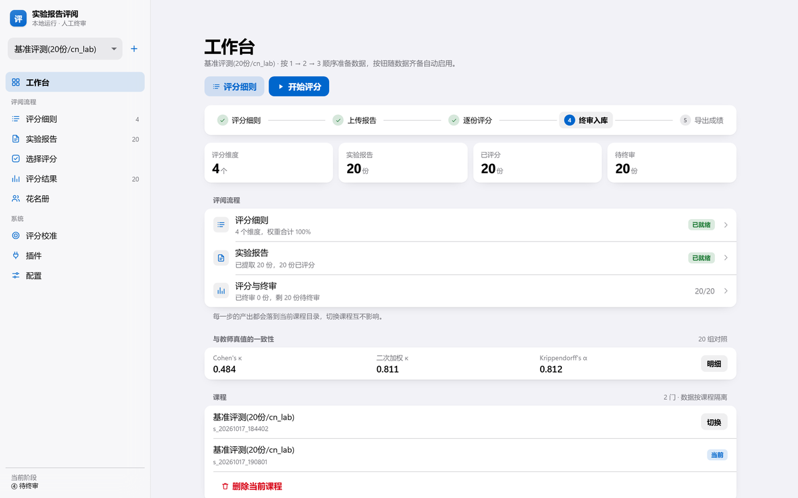
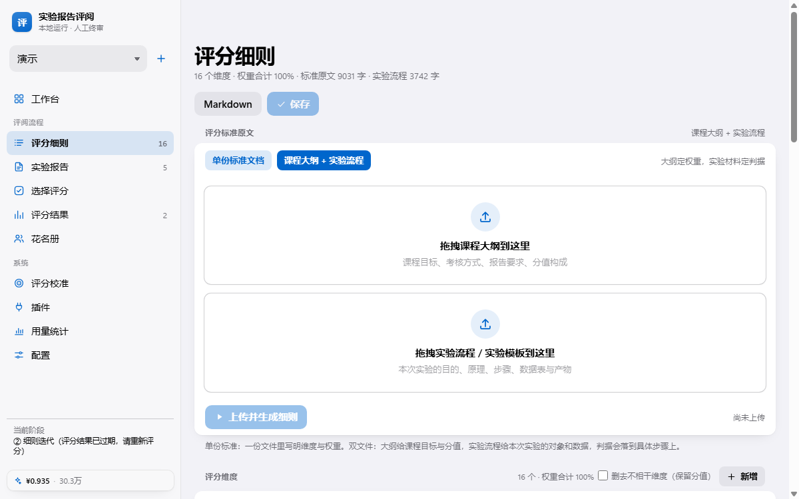
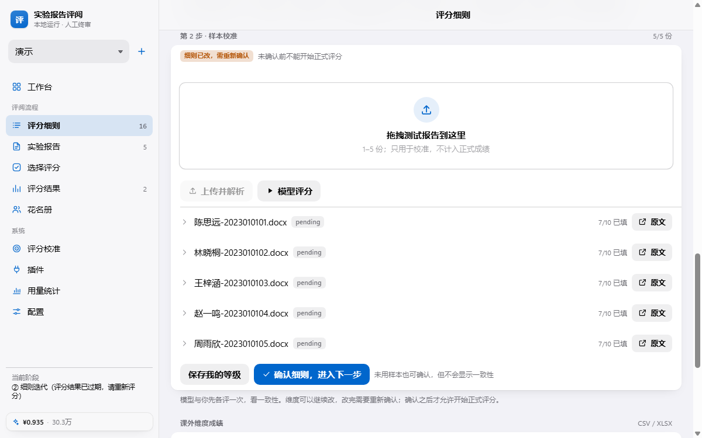
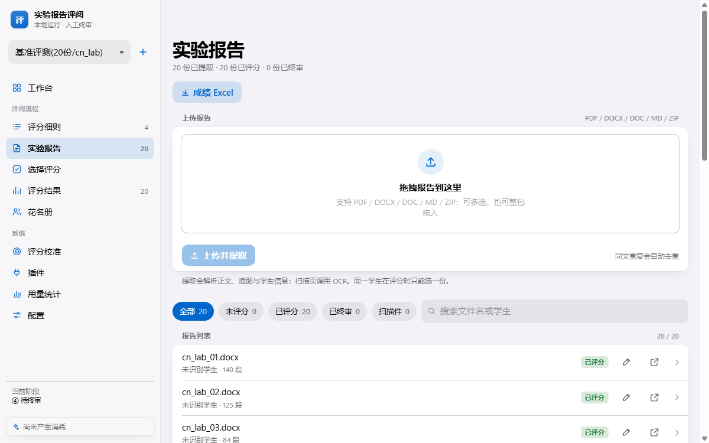
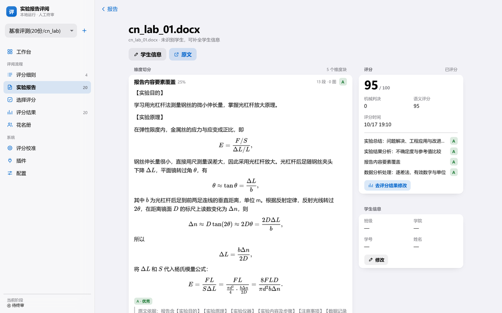
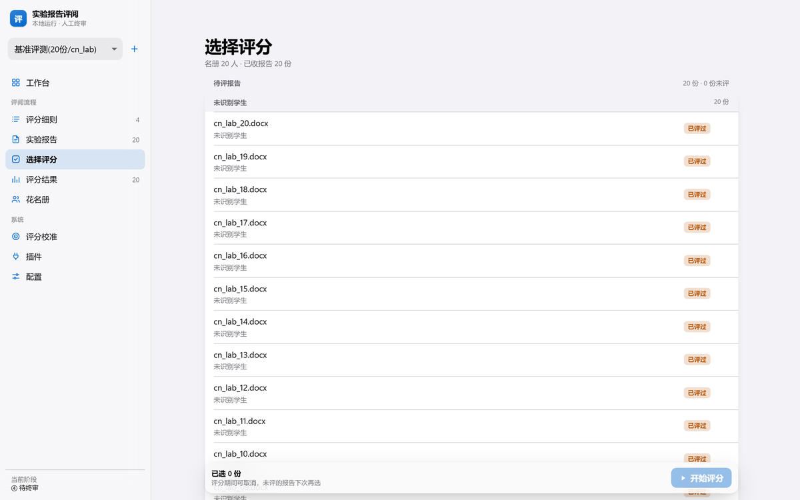
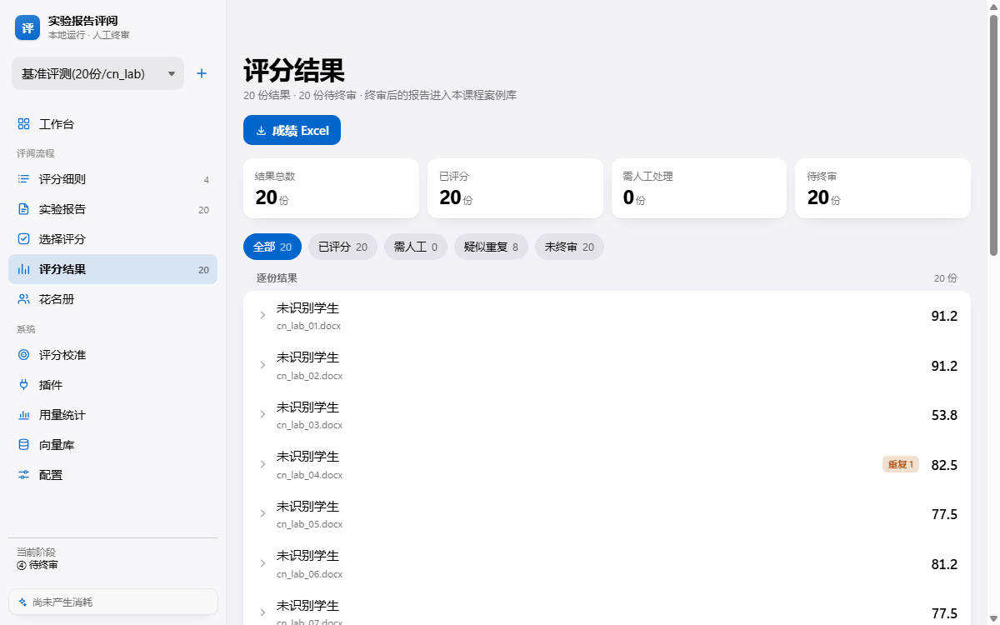
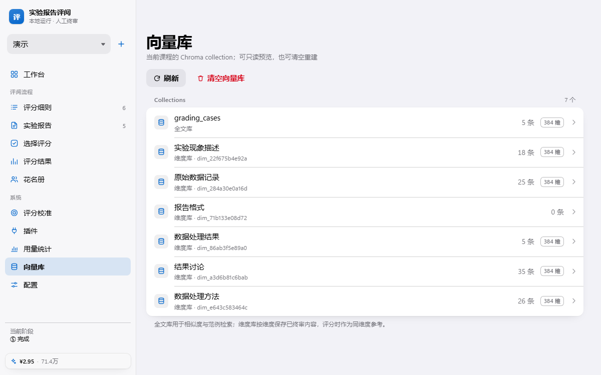
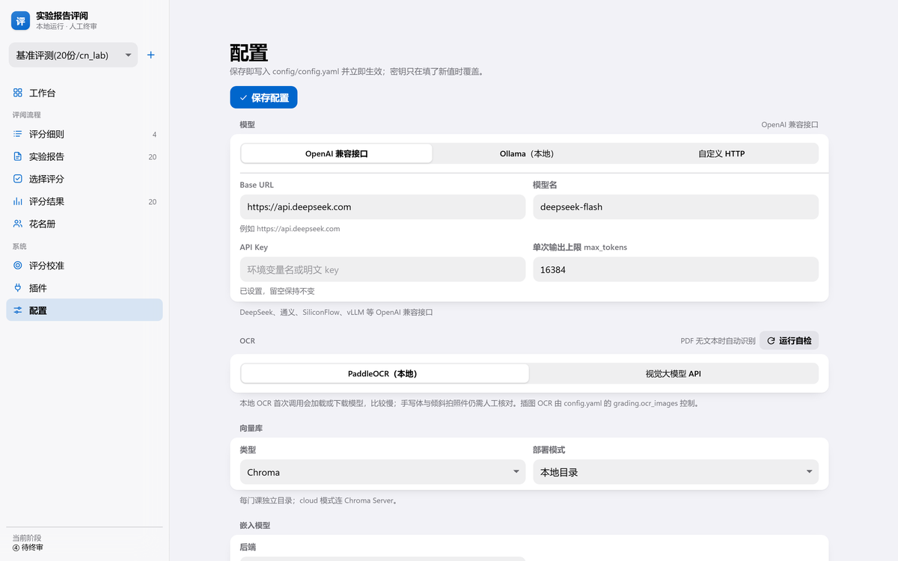
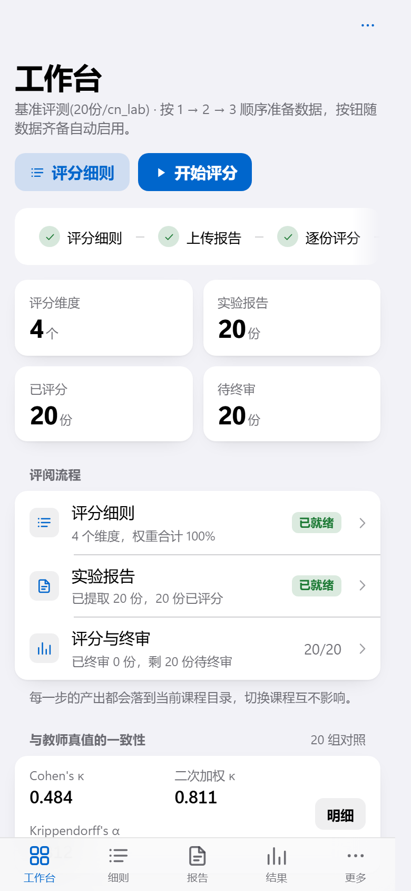

# 实验报告智能评阅系统（Common-Lab-Report-Grader）

> 本地运行。先拆维度、用 ≤5 份样本校准并确认，再批量评分。

把「课程评分标准 + 学生实验报告」丢进去，系统按维度判 A–E 级、查内容安全与重复，你逐份终审后导出成绩 Excel。报告与成绩只存在本机；调用云端模型时正文会发给模型供应商，切到 Ollama 可完全离线。



<div align="center"><sub>工作台：左侧是课程与导航，中间按 1 → 5 步显示当前进度</sub></div>

---

## 目录

| 我想……               | 看这里                             |
| ------------------ | ------------------------------- |
| 先看看它长什么样           | [界面预览](#界面预览)                   |
| 马上把它跑起来            | [5 分钟跑起来](#5-分钟跑起来)             |
| 第一次用，不知道点哪         | [第一次使用的完整流程](#第一次使用的完整流程)       |
| 报错了                | [常见问题](#常见问题)                   |
| 改模型 / 改 OCR / 改向量库 | [配置速查](#配置速查)                   |
| 给评分加学科参考（MCP）      | [MCP 插件](#mcp-插件)               |
| 做二次开发              | [项目结构](#项目结构) · [开发与测试](#开发与测试) |

---

## 这是什么

**给谁用**：高校实验课教师、助教，尤其是要批几十上百份 Word/PDF 实验报告的场景。

**它解决四件事**：

1. **判级不靠手感**：把评分标准拆成若干维度（每个维度 A–E 五级判据 + 权重），模型逐维度找证据、给等级，总分按权重自动算。
2. **先用样本对齐**：拿 ≤5 份测试报告，模型和你各评一次，给出 κ / 加权 κ / α；认可后才确认细则进入正式评分。
3. **可疑的先挑出来**：全文相似度查雷同、提示注入检测、内容安全检测，命中就拦下来交人工，**不会静默给分**。
4. **终审还是你说了算**：每份报告可以改等级、写评语、打回重评；终审过的报告进本课程案例库，越用越像你的评分习惯。

**它不做什么**：不替你做最终决定（所有分数都要你终审）；不自动判定抄袭（只给相似度提示）；不把数据传到本系统的服务器（云端模型调用除外）。

---

## 这次更新

- **细则双文件**：除单份标准外，可以「课程大纲 + 实验流程/实验模板」一起生成，判据会落到具体实验步骤。
- **样本校准**：≤5 份测试报告，模型与你各评一次，显示 κ / 加权 κ / α；确认后才允许正式评分。
- **非报告维度**：预习、课堂、操作等全部保留但默认停用，权重不动、导出留空列；可上传成绩单补分。
- **报告表格**：DOCX/PDF 提取出的 Markdown 表格现在会还原成表格，不再显示成一堆竖线。
- **上传框**：支持拖拽，边框与留白重做；报告与标准各自独立，不再串任务。
- **经典版退役**：Jinja 模板、旧样式与 `/classic`、`/rubric_review` 等历史兼容路径已全部删除，页面统一走 SPA。
- **向量库管理**：新增「系统 → 向量库」页，列出当前课程的 collection、条数、维度与元数据，可逐条查看正文与向量预览；支持清空当前课程向量库。

---

## 界面预览

> 截图取自内置课程（演示与基准数据）。部分基准数据的 docx 没有学生姓名，所以显示「未识别学生」——真实使用时姓名/学号会自动提取。

**评分细则** —— 单份标准，或「课程大纲 + 实验流程」双文件；全部考核项都会提取，报告里没有证据的维度默认停用（可取消），权重保留。



**样本校准** —— 上传 ≤5 份测试报告，模型与你各评一次，显示 κ / 加权 κ / α；确认后「开始评分」才会启用。



**实验报告** —— 拖拽或点选，支持多选与整包上传；正文里的表格、公式按原文渲染。



**报告详情** —— 正文按维度切块挂载，表格与 KaTeX 公式原样显示；右侧是总分与逐维度等级。



**选择评分** —— 勾选本次要评的报告，同一学生只能选一份；细则未确认时按钮禁用。



**评分结果** —— 展开就能看到每个维度的判级理由与原文依据，可改等级、写教师说明、终审或打回重评。



**向量库** —— 列出当前课程的全部 Chroma collection，查看条数、维度、元数据，以及每条数据的正文、元数据与向量预览；默认只读，右上角可清空当前课程的向量库，需二次确认。



**配置** —— 模型、OCR、向量库、嵌入模型，保存即生效，内置 OCR 自检。



手机/窄窗口下边栏会变成底部标签栏，功能和桌面一致：

<div align="center"></div>

---

## 5 分钟跑起来

### 0. 先确认你装了什么

| 需要                     | 版本                                         | 怎么确认               |
| ---------------------- | ------------------------------------------ | ------------------ |
| Python                 | 3.10 以上                                    | `python --version` |
| Node.js（只用于构建前端，装一次就行） | 18 以上                                      | `node --version`   |
| 一个大模型的 API Key         | OpenAI 兼容即可（DeepSeek、通义、SiliconFlow、vLLM…） | 去对应平台申请            |

> 只是想看界面、暂不评分？可以跳过第 3 步的 Key，除「生成细则 / 评分」外的页面都能正常打开。

### 1. 装 Python 依赖

**Windows（PowerShell 或 CMD）**

```bat
cd 项目目录
python -m venv .venv
.venv\Scripts\activate
pip install -r requirements.txt
```

**macOS / Linux**

```bash
cd 项目目录
python3 -m venv .venv
source .venv/bin/activate
pip install -r requirements.txt
```

看到命令行前面多了 `(.venv)` 就对了。

> `paddleocr`、`chromadb` 体积较大，这一步可能要好几分钟；如果只报 OCR 相关的编译错误，可以先把 `requirements.txt` 里的 `paddleocr`、`paddlepaddle` 注释掉再装，其余功能照常。

### 2. 构建前端（只有第一次需要）

```bash
cd frontend
npm install --registry=https://registry.npmmirror.com
npm run build
cd ..
```

成功的话最后会打印类似 `✓ built in 1.5s`，并生成 `src/experiment_report_grader/static/ui/`。

> `npm install` 慢或超时，先换国内镜像：`npm config set registry https://registry.npmmirror.com`。
>
> 如果 `npm` 命令不存在，说明 Node.js 没装好，去 [nodejs.org](https://nodejs.org/) 装 LTS 版。

### 3. 配置模型

二选一，**新手推荐第 2 种**。

**方式 A：改配置文件**

```bash
cp config/config.example.yaml config/config.yaml     # Windows 用 copy
```

打开 `config/config.yaml`，改这三行：

```yaml
llm:
  backend: "openai"
  openai:
    api_key: "DEEPSEEK_API_KEY"        # 填环境变量名，或直接填 sk-xxxx
    base_url: "https://api.deepseek.com"
    model: "deepseek-chat"
    max_tokens: 16384
```

**方式 B：启动后在界面里填**

先启动（下一步），打开左侧「配置」，选协议、填 Base URL / 模型名 / API Key，点「保存配置」，立即生效。

### 4. 启动

```bash
python run.py
```

看到这行就成功了：

```
Starting Experiment Report Grader on http://127.0.0.1:5000
```

浏览器打开 <http://127.0.0.1:5000>，应该看到最上面那张「工作台」。

需要换端口或让同一局域网的其他电脑访问：

```bash
python run.py --port 8080 --host 0.0.0.0
```

（`--host 0.0.0.0` 会暴露到局域网，仅在你信任的网络里使用。）

---

## 第一次使用的完整流程

工作台上的按钮会**按数据是否齐备自动启用/禁用**，跟着 1 → 5 步走就不会错。

### ① 上传评分标准 → 生成细则

进入 **评分细则**，有两种模式：

- **单份标准文档**：一份文件里已经写明维度、权重和分级要求；
- **课程大纲 + 实验流程**：大纲给课程目标与分值构成，实验流程/实验模板给本次实验的目的、步骤、数据与产物。判据会落到「大纲条目 + 实验步骤」两个位置，比单份标准更具体。

生成后检查：

- **权重**：保存时自动归一到 100%，不用自己凑数；
- **A–E 判据**：写得越具体，判级越稳；
- **补全**按钮：只补空着的字段，不会覆盖你改过的内容；字段全满时按钮禁用；保存后为空的字段会重新生成，缺字段会提示而不是静默跳过；
- **机械判决**：能程序化判的维度（比如「是否给出逐差法」）打开开关，交给沙箱里的裁判代码判断；
- **删去不相干维度（保留分值）**：预习、课堂、考勤、操作、自评等报告里没有证据的维度会被标出来，默认停用；不想停就取消勾选。停用后权重保留，导出时该列留空，之后可以用「课外维度成绩」补分。

改完点右上角「保存」。**保存前会二次确认：细则一变，已提取的报告、评分结果与向量库会全部删除（上传的原件保留，重新点「处理」即可），校准确认同步失效**——这是故意的，避免新旧标准混用。首次生成或课程还没有下游数据时直接保存，不打扰。

### ② 样本校准（确认后才能正式评分）

在同一个页面的 **第 2 步 · 样本校准**：

1. 上传 **≤5 份**测试报告（只用于校准，不计入正式成绩）；
2. 点「模型评分」，按当前维度逐份打分；
3. 展开每份报告，能看到 **原文**（只读抽屉）和每个维度实际挂载的段落；按你的判断逐维选 A–E；
4. 点「保存我的等级」，页面显示 Cohen's κ、二次加权 κ、Krippendorff's α 和样本对数；
5. 维度可以继续改，改过的会标「已改」；改完需要重新确认，但**不会自动重新生成细则**；校准样本可单份删除（连同解析结果与上传原件）；
6. 确认无误点「确认细则，进入下一步」。确认后系统会为每个维度建立空 collection，终审时再写入内容；没确认或细则又改过时，`开始评分` 会拒绝启动。

没有测试报告也可以直接确认，但不会有一致性数据。

### ③ 上传实验报告

进入 **实验报告**，可以多选文件、拖拽到上传框，或直接丢一个 `.zip` / `.rar` / `.7z` 压缩包。除 PDF/DOCX/DOC/MD 外，还支持 `.html` / `.pptx` / `.xlsx` / `.epub`——这些格式本地解析器不处理，会经 **markitdown 插件**（`pip install markitdown-mcp` 后在插件页或 `config/mcp.yaml` 注册）转成 Markdown；插件缺席时这些格式会被跳过，其余行为不变。系统会：

- 提取正文、表格、插图、学生信息（姓名/学号/班级，按花名册表头来）；
- 扫描件/无文本 PDF 自动走 OCR；
- 同一份报告重复上传时自动去重；
- 报告里的表格会按 Markdown 表格还原，公式交给 KaTeX 渲染。

列表里每行可以直接改学生信息、打开原文；点整行进详情。**每行有删除按钮**（二次确认）：会一并删除该报告的提取目录、上传原件、评分结果、向量记录与终审记录。

### ④ 选择报告 → 开始评分

进入 **选择评分**，勾选这次要评的报告，点右下角「开始评分」。

- 细则未确认时，按钮禁用，页面会提示先去校准；
- 同一学生有多份时只能选一份（选了第二份会自动取消第一份）；
- 已终审的报告不会出现在列表里；
- 评分在后台跑，可以离开这个页面，回工作台能看到进度。

单份大约 10–40 秒。模型失败的报告会标成「模型失败」，**不会伪造成 C 分**，可以单独重评。

### ⑤ 终审与导出

进入 **评分结果**，点开任意一份：

- 每个维度都有：AI 判级 + 理由 + 原文依据；
- 你不同意就点 A–E 改等级，可以在「教师说明」里写原因（重评时会进提示词）；
- 点「保存修改」只改分数，「终审入库」才会写入成绩并进案例库；
- 拿不准就「打回重评」，填写修改意见。

终审完成后，右上角「成绩 Excel」导出全部成绩。停用的维度在表里保留列但为空；如果上传过「课外维度成绩」，这一列会自动填入分数并计入总分，成绩单也提供「清除」按钮（已并入的分数自动回滚、小计重算）。

### ⑥ 可选的三个加分项

| 功能          | 什么时候用                                                 |
| ----------- | ----------------------------------------------------- |
| **花名册**     | 想让系统自动列「谁没交」「谁学号不在名单里」。上传 `.xlsx/.csv`，表头决定提取和导出列。 |
| **评分校准（单份试评）** | 只想拿一份报告深挖分歧。上传教师已判过的报告，系统给出逐维度分歧原因和细则修订建议。 |
| **插件（MCP）** | 有学科参考服务（比如物理实验的不确定度规范），想让评分时带上这些资料。 |

---

## 常见问题

| 现象                              | 原因与处理                                                            |
| ------------------------------- | ---------------------------------------------------------------- |
| 打开是空白页 / 404                    | 前端还没构建。执行 `cd frontend && npm install && npm run build`，再刷新。     |
| 端口被占用（`Address already in use`） | 换端口：`python run.py --port 5001`                                  |
| 页面能开，生成细则报错                     | 「配置」页检查 Base URL / 模型名 / API Key；`api_key` 填的是环境变量名时，确认该变量真的设置了。 |
| 细则维度全被丢弃                        | 模型没给出「标准文档位置」。换个更强的模型重试，或在细则页手动新增维度后逐格「补全」。                      |
| 出现「预习报告 / 课堂表现」这类维度           | 这是有意保留的，默认已停用。要计入就取消标题旁「删去不相干维度」的勾选，或上传课外成绩单。                     |
| 导出里某几列是空白                       | 这些维度被停用了：权重保留、不参与报告评分。上传「课外维度成绩」或取消停用即可填上。                       |
| 点「开始评分」没反应 / 提示先确认             | 细则还没做样本校准并确认。去「评分细则 → 第 2 步」点「确认细则，进入下一步」。                      |
| 样本一致性很低（甚至是负数）                 | 样本太少（n<10）或维度边界本身模糊。先把判据写具体，再重跑模型评分。                              |
| 报告详情里维度显示「0 段」                 | 这是修复归档逻辑前的旧结果。对报告「打回重评」或重新评分一次。                                   |
| 表格显示成一堆竖线 / 公式没渲染              | 前端是旧构建产物。`cd frontend && npm run build` 后刷新。                       |
| 评分结果全是 C，提示「LLM 未返回该维度」         | 模型输出不是 JSON。换模型重试，或对这份报告「打回重评」。                                  |
| 报告状态 `模型失败`                     | 同上，未返回可解析的 JSON；报告不计入成绩，可直接重评。                                   |
| 首次 OCR 特别慢                      | paddleocr 首次会加载/下载模型，之后就快了。                                      |
| Chroma 报错（库被占用）                 | 本地向量库在 `data/output/sessions/<课程>/kb_db`，关掉旧的 python 进程再启动。      |
| 想清空重来                           | 工作台底部「删除当前课程」只从列表移除，本地目录不会自动删；需要时手动删除 `data/output/sessions/<课程>/`。 |

---

## 配置速查

| 键                                              | 说明                                       | 默认                           |
| ---------------------------------------------- | ---------------------------------------- | ---------------------------- |
| `llm.backend`                                  | `openai` / `ollama` / `custom`（配置页可切换）   | `openai`                     |
| `llm.openai.api_key`                           | 环境变量名或明文 key（先查同名环境变量）                   | `DEEPSEEK_API_KEY`           |
| `llm.openai.base_url` / `model` / `max_tokens` | 接口地址、模型名、单次输出上限                          | —                            |
| `llm.ollama.base_url` / `model`                | 本地 Ollama 地址与模型                          | `http://localhost:11434` / — |
| `llm.custom.base_url` / `api_key` / `model`    | 自定义 HTTP 网关                              | —                            |
| `ocr.backend`                                  | `paddleocr`（本地）或 `api`（视觉大模型）            | `paddleocr`                  |
| `ocr.paddleocr.language`                       | OCR 语言                                   | `ch`                         |
| `ocr.api.api_url/api_key/api_model`            | 视觉 OCR 接口                                | —                            |
| `grading.similarity_threshold`                 | 全文相似度告警线                                 | `0.92`                       |
| `grading.similarity_reject`                    | 判为高度重复的线                                 | `0.97`                       |
| `grading.workers`                              | 并行评分份数（配置页可改，1–8，写回本文件）            | `3`                         |
| `grading.ocr_images`                           | 是否对报告插图跑 OCR（结果缓存在 `reports/*/.ocr/`）    | `false`                      |
| `vector_store.backend`                         | 向量库类型                                    | `chroma`                     |
| `vector_store.chroma.mode`                     | `local`（每课程独立目录）或 `cloud`（Chroma Server） | `local`                      |
| `vector_store.embedding.backend`               | `default`（内置离线）或 `openai`（`/embeddings`） | `default`                    |
| `storage.backend`                              | `auto`（配了 dsn 用 PG）或 `file`             | `auto`                       |
| `storage.postgres.dsn`                         | PostgreSQL 连接串（环境变量 `ERG_PG_DSN` 优先）；留空/连不上自动回退本地文件 | `""`              |

> 曾有"文件首行标 `checked` 的受保护文件"约定，现已退役：所有文件按普通代码对待，改动走正常 review；能力扩展仍建议优先走新模块。

---

## 数据在哪 / 隐私

- 默认所有数据只落在本机 `data/output/sessions/<课程>/`：`rubrics/`（细则与两份原文）、`pilot/`（样本校准的报告与 AI/教师等级）、`reports/`（正文、插图、meta）、`grading/`（结果与导出）、`uploads/`（原件）。
- **可选 PostgreSQL**：`storage.postgres.dsn` 配置后，全部结构化数据（细则、报告正文与 meta、评分结果、终审、用量、教师重评意见、任务/评分终态、校准工作区）改存 PostgreSQL，首次启用会自动把本地已有 JSON 一次性导入；未配置或连接失败时静默回退本地文件，行为与原来完全一致。**不迁**的仍是本地文件：报告插图与上传原件、Excel 导出、Chroma 向量库。教师重评意见与任务终态原先只在内存（重启即丢），现在无论哪个后端都会持久化。
- 停用维度的成绩单存在 `<课程>/external_scores.json`；合并结果会写回各报告的小计。
- `config/config.yaml` 里可能有明文 key，**已被 `.gitignore` 排除**，不要提交。
- 进入 RAG 案例库前会做隐私脱敏：姓名、学号、电话、邮箱、身份证、住址替换为占位符（模型不可用时用正则兜底）。
- 关掉浏览器不会丢数据；重开 `python run.py` 会自动恢复上次的课程、样本校准与评分结果。

---

## MCP 插件

有学科参考服务时可以挂上来，给评分补充资料。没有就跳过。

在「插件 → 添加插件」填表单，或直接写 `config/mcp.yaml`：

```yaml
servers:
  physics-ref:
    transport: stdio
    command: npx
    args: ["-y", "@your/physics-ref-server"]
    note: "物理实验学科参考"
  lab-http:
    transport: http
    url: "http://127.0.0.1:8931/mcp"
```

然后到「插件 → 挂载到当前课程」勾选服务器，可选填资源过滤（`ref://physics/*`）、检索工具名、学科提示词名、参考文本上限（默认 4000 字符）。

评分开始前会收集一次参考文本，注入提示词的「学科参考资料」段。插件不可用/超时时参考为空、评分继续，页面会显示每台服务器的状态与错误原因。

详见 [docs/MCP.md](docs/MCP.md)。

---

## 评分怎么算（想核分时看）

- **等级与分值**：`A=95, B=80, C=60, D=40, E=0`；总分 = Σ(维度等级分 × 权重)。
- **E 的含义**：不是「比 D 更差」，而是「未实现 / 缺失 / 整卷跑题 / 抄袭 / 白卷」。
- **停用维度**：预习、课堂、考勤、操作、自评等标 `non_report` 的维度默认停用，不送进评分提示词；权重保留、导出留空列，总分上限相应低于 100。取消停用即可重新计入。
- **并行评分**：默认 3 份报告同时跑；单份内部注入检测与内容安全并行、维度归类与判级并行。模型提示词、判据、维度都不变。环境变量 `ERG_GRADING_WORKERS=1..8` 可调，默认 3；遇到 429/本地显存不够就调成 1 或 2。
- **课外成绩单**：细则页可上传 `.xlsx/.csv`（列含学号/姓名 + 维度名，分数写 A–E 或 0–100），按学号优先合并进结果，重算小计；该维度显示「已打分」。
- **机械判决**：可程序化判的维度由模型生成 `verify(text)` 函数，在 AST 白名单 + 受限 builtins（只允许 `re / math / json`）的沙箱里执行；生成或执行失败回退细则里的 `rules`（`exists` / `numeric_compare`）。
- **维度归一与归档**：模型自创的维度名先按「精确 → 包含 → 相似度」对齐回细则名单，也接受直接返回序号；归一失败的维度记 C 并标「请人工复核」。正文归类完全失败时按维度名的字符二元组做关键词兜底挂载，至少不会全进「未挂载内容」。
- **防跑题**：提示词与细则生成都加了强约束——与实验主题无关的内容不得高于 D。
- **RAG**：终审报告进全文库（算相似度）；每个学生每个维度只写**一条**汇总向量（该维度所有段落/图片合并成一个大块），没有内容就不写；维度 collection 在细则确认时建立，终审时才写入。示例报告按等级取前 1–2 份做 few-shot。
- **相似度**：整篇报告一个向量，余弦最近邻，`≥0.92` 告警、`≥0.97` 标「高度重复」。默认用 Chroma 内置的 MiniLM（英文语料、256 token 截断），模板化报告前几百字相同就会接近 1.0，这时只适合当提示、不适合当判据；需要更准时在配置里换 `text-embedding-3-small` 一类，并重新标定阈值。
- **一致性与缓存**：HTTP 客户端跨调用复用连接池；同一份正文的 query embedding 只算一次，维度参考不再逐维重算。样本校准页显示 Cohen's κ、二次加权 κ、Krippendorff's α。

### 模型失败时怎么办（兜底矩阵）

| 环节            | 失败后的行为                           |
| ------------- | -------------------------------- |
| 提示注入检测        | 标记 `detection_failed`，转人工，不评分    |
| 注入检测文本超 2 万字符 | 标记 `audit_truncated`，转人工，不静默放行   |
| 内容安全          | fail-open 放行，但记录「安全检测失败」         |
| 隐私脱敏          | 回退正则兜底（隐私是红线，必须替换）               |
| 细则生成          | 指向不了文档位置的普通维度丢弃并警告；`non_report` 维度允许缺 doc_ref，保留待用户停用；一个都不剩则任务失败 |
| 样本校准          | 单份模型评分失败标 `llm_failed`，不写分数；可重跑，确认状态不受影响 |
| 维度归类          | 名称对不齐时按「精确/包含/相似度」兜底；仍为空则用关键词挂载，最后才进「未挂载内容」 |
| 课外成绩单         | 解析失败/列名不匹配直接报错，不覆盖已有分数               |
| 报告评分          | 无可用分数 → `llm_failed`，不计入成绩，可一键重评 |
| 学生信息提取        | 字段留空，人工在页面补                      |
| MCP 工具/资源/提示词 | 单台失败只写状态，参考为空，评分继续               |

不依赖模型的部分（权重归一、小计、相似度、导出、花名册匹配）不受影响。

---

## 项目结构

```
run.py                      启动入口（--host / --port / --debug）
config/
  config.example.yaml       配置模板（复制成 config.yaml 再改）
  config.yaml               你的运行配置（含密钥，不入库）
  mcp.example.yaml          MCP 示例
src/experiment_report_grader/
  app.py                    所有 HTTP 路由（编排层；含 /pilot/* 样本校准、/rubric_external_upload）
  factory.py                模型实例工厂（测试替换点）
  storage.py                统一持久化入口：本地文件 / PostgreSQL 双后端，PG 不可用静默降级
  web/state.py              课程会话、目录、审批记录、MCP 挂载、状态恢复
  web/tasks.py              上传处理的后台任务进度
  nodes/                    评分业务
    grader.py               判级主流程、维度归一、RAG、相似度、导出
    rubric_generator.py     细则生成 / 单元格补全 / 校准对比
    rubric_io.py            权重归一、小计、校验、Markdown
    verifier.py             机械判决：生成裁判代码 + 沙箱执行 + 规则回退
    agreement.py            一致性指标（κ / 加权 κ / α）
    external_scores.py      课外维度成绩单：解析结果、按学号合并、重算小计
  utils/                    模型客户端、文档解析、OCR、注入检测、内容安全、隐私脱敏
  mcp/                      MCP 客户端（stdio / http JSON-RPC）与插件注册表
  static/                   前端构建产物、KaTeX、favicon
frontend/                   React 19 + Vite 6 的 SPA（无组件库）
  src/pages/                13 个页面，一页一文件
  src/ui/                   按钮、分组列表、sheet、等级选择器等基础件
  src/lib/                  请求、路由、数据钩子、上下文、Markdown/公式
  src/styles.css            设计令牌与全部样式
docs/
  PROJECT_STRUCTURE.md      模块职责、数据流、扩展点
  MCP.md                    插件协议、示例、排障
  TESTING.md                测试矩阵与实测结果
tests/
  run_all.py                零依赖测试入口（无需 pytest）
  unit/                     单元测试
  integration/              端到端点击流程 + 基准跑批
  fixtures/                 假 MCP 服务、cn_lab 基准材料
```

---

## 开发与测试

```bash
# 后端测试（85 项，不需要 pytest）
python tests/run_all.py
python tests/run_all.py -k mcp        # 按名字过滤

# 前端开发模式（热更新，代理到 127.0.0.1:5055 的后端）
cd frontend && npm run dev

# 改完前端重新构建
cd frontend && npm run build
```

`python run.py` 默认跑在 5000；前端开发服务器默认 5174，代理目标写在 `frontend/vite.config.js`，需要后端跑在 5055（`python run.py --port 5055`）。

基准跑批（调用真实模型，会产生费用）：

```bash
python tests/integration/bench_run.py tests/fixtures/bench/cn_lab
```

OCR 自检：

```bash
python scripts/ocr_check.py                  # 用配置里的后端
python scripts/ocr_check.py --backend api
```

也可以点「配置 → OCR → 运行自检」。本机实测（paddleocr 3.7，印刷体中英混排，阈值 0.85）：期望文本与识别结果平均相似度 1.000（仅空格差异被忽略）；手写体与低分辨率拍照件仍需人工核对，这类报告会被标为「扫描件」。

---

## 已知限制

- **单进程内存态**：同一课程只支持一位教师同时操作（评分线程有锁，但状态在进程内）。评分/上传等后台任务已做会话隔离：运行中切换课程，旧任务只写旧会话，不会污染当前课程。
- **相似度只做提示**：整篇一个向量，长报告与模板化报告会被嵌入模型截断，不能当抄袭判据；也没有做段落级比对。
- **送模型的正文上限 8000 字符**（超出部分不参与评分），插图取前 20 张描述。
- **停用维度的总分上限低于 100**：权重按约定保留、不重算，想补齐要么取消停用，要么上传课外成绩单。
- **样本校准最多 5 份**：n 小的时候 κ 波动很大，只能看方向，不能当统计结论。
- **OCR 对手写体、拍照倾斜件效果有限**。
- **一致性分析需要教师真值**：样本校准里是你手填的等级；结果页的 κ 需要 `teacher_grades.json`。
- **一次评分不是一次模型调用**：注入检测、内容安全、维度归类、判级各一次，几十份报告会产生相应费用，建议先用 3–5 份试跑。
- **默认并发 3**：供应商限流或本地 Ollama 显存不足时，把 `ERG_GRADING_WORKERS` 调到 1；并发只影响吞吐，不改变判级标准。

## 许可

MIT，见 [LICENSE](LICENSE)。
