# 实验报告智能评阅系统 · Common-Lab-Report-Grader

把「课程评分标准 + 一堆学生实验报告」丢进来，系统先把标准拆成带权重的维度，用 ≤5 份样本和你对齐判级口径，再逐份找证据判 A–E、查雷同与内容安全，最后由你终审、导出成绩 Excel。

全程**本地运行**：报告与成绩只落在你自己的机器上。唯一的例外是调用云端大模型时正文会发给模型供应商——换成 Ollama 即可彻底离线。

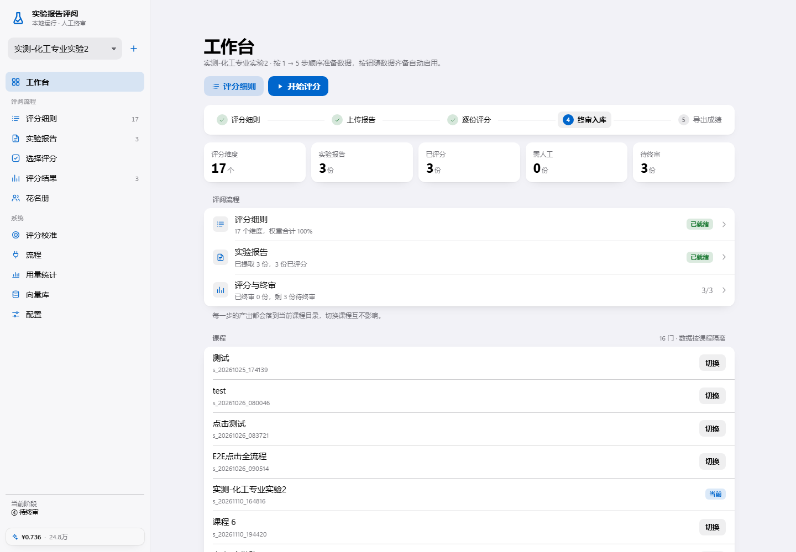

<div align="center"><sub>工作台：左侧导航 + 顶部 1→5 步进度 + 统计卡；按钮随数据是否齐备自动启用</sub></div>

---

## 目录

| 我想做的事 | 直达 |
| --- | --- |
| 先看懂它怎么跑 | [运行链路图](#运行链路图) · [它解决什么](#它解决什么) |
| 看看每个页面长什么样 | [界面预览](#界面预览) |
| 把它跑起来 | [5 分钟跑起来](#5-分钟跑起来) |
| 第一次用，跟着走一遍 | [完整使用流程](#完整使用流程) |
| 想知道分数怎么算出来的 | [评分是怎么算的](#评分是怎么算的) |
| 模型挂了会怎样 | [失败兜底矩阵](#失败兜底矩阵) |
| 改模型 / OCR / 向量库 | [配置速查](#配置速查) |
| 挂学科参考、给评分加工具 | [能力挂载（MCP / 技能 / 计算）](#能力挂载mcp--技能--计算) |
| 报错了 | [常见问题](#常见问题) |
| 做二次开发 | [项目结构](#项目结构) · [开发与测试](#开发与测试) |

---

## 运行链路图

一张图看完整条评阅管线：左列是 9 个节点的真实顺序，中列是每个节点背后的模块与输入输出，右列是数据层、模型与可插拔能力源。

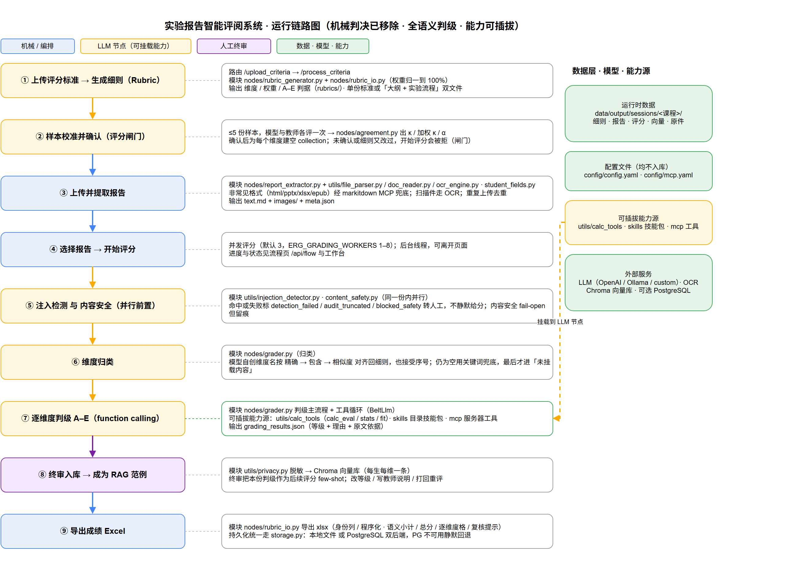

> 源文件是可编辑的 [`docs/项目运行链路图.drawio`](docs/项目运行链路图.drawio)，用 [draw.io / diagrams.net](https://app.diagrams.net) 打开即可改。上图是它的渲染快照（Markdown 不能直接内嵌 drawio，所以截图放进来）。

颜色即职责：

- 🟦 **机械 / 编排** —— 提取、选择、导出这类不调模型的步骤；
- 🟨 **LLM 节点（可挂载能力）** —— 细则、校准、注入、安全、归类、判级，每个都能按需挂计算 / 技能 / MCP 工具；
- 🟪 **人工终审** —— 唯一由你拍板的环节；
- 🟩 **数据 · 模型 · 能力** —— 本地目录、配置、外部服务与可插拔能力源。

---

## 它解决什么

**给谁用**：要批几十上百份 Word/PDF 实验报告的高校实验课教师和助教。

四件事：

1. **判级有据可依**——评分标准被拆成若干维度，每个维度带 A–E 五级判据和权重；模型逐维度找原文证据、给等级，总分按有效权重自动折算回百分制。
2. **先对齐再批量**——拿 ≤5 份样本，模型和你各判一次，给出 Cohen's κ / 二次加权 κ / Krippendorff's α；你认可后确认细则，「开始评分」才会放行。
3. **可疑的先挑出来**——全文相似度查雷同、提示注入检测、内容安全检测三道前置；命中或检测失败一律转人工，**绝不静默给分**。
4. **终审你说了算**——每份可改等级、写教师说明、打回重评；正文在评分时就进本课程查重库，终审后这份的判级成为后续报告的 few-shot 范例，越用越贴近你的习惯。

**它不做**：不替你做最终决定（分数都要你终审）；不自动判抄袭（只给相似度提示）；不把数据传到本系统的服务器（云端模型调用除外）。

---

## 界面预览

> 截图全部取自本机真实服务、真实模型跑出的演示课程（合成基准数据，无真实学生隐私）。基准 docx 正文里没写可提取的姓名，所以列表显示「未识别学生」——真实使用时姓名 / 学号 / 班级会按花名册自动提取。

导航分三组：**工作台**；**评阅流程**（评分细则 · 实验报告 · 选择评分 · 评分结果 · 花名册）；**系统**（评分校准 · 流程 · 用量统计 · 向量库 · 配置）。

**① 评分细则** —— 单份标准，或「课程大纲 + 实验流程」双文件；全部考核项都会提取，报告里没证据的维度（预习 / 课堂 / 考勤等）默认停用但保留权重。

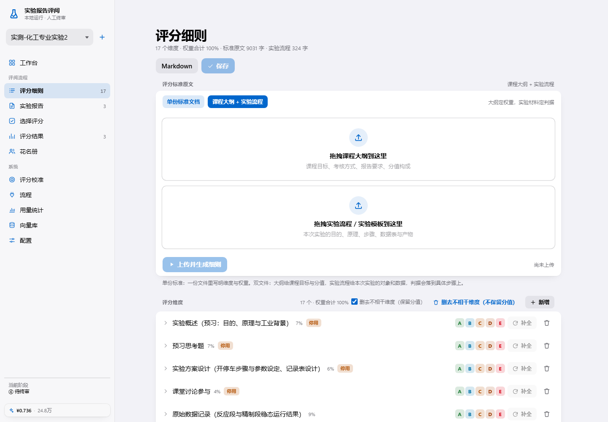

**② 实验报告** —— 拖拽、多选或整包上传（zip/rar/7z）；正文里的表格按 Markdown 还原、公式交给 KaTeX，扫描件自动走 OCR，重复上传去重。

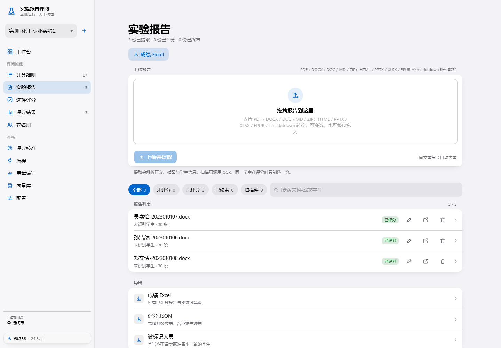

**③ 选择评分** —— 勾选本次要评的报告，同一学生只能选一份；细则未确认时按钮禁用并提示先去校准。

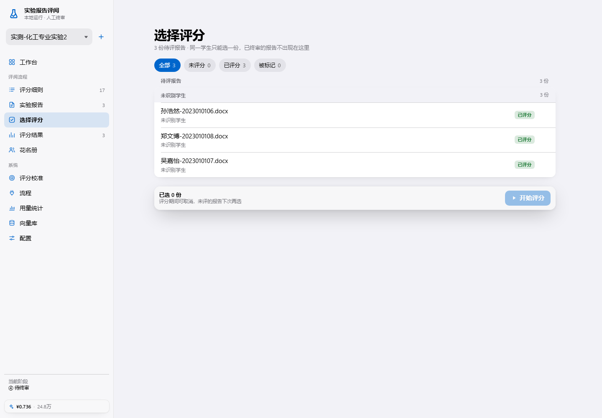

**④ 评分结果** —— 逐份列出判级，带「复核」「疑似重复」标记；展开可改等级、写说明、终审或打回重评，右上角导出成绩 Excel。

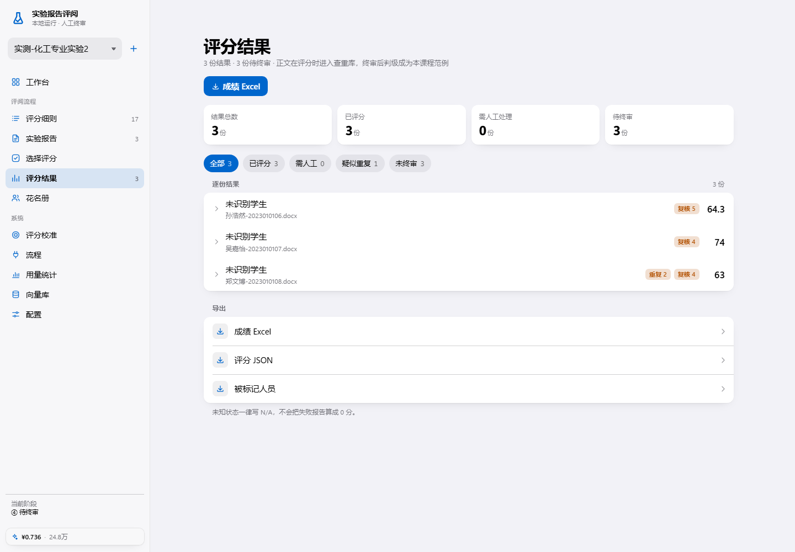

**报告详情** —— 正文按维度切块挂载，真实表格与公式原样显示；右侧是总分与逐维度 A–E 等级，每个维度附「原文依据」。

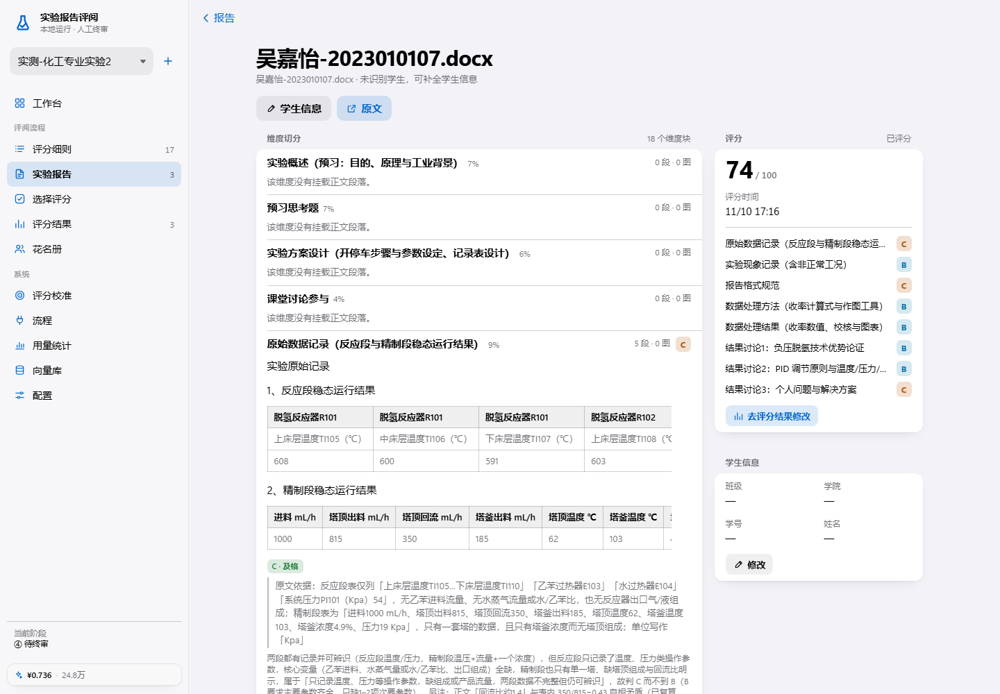

**⑤ 流程** —— 9 节点管线与各节点状态；带 ⚡ 的 LLM 节点可挂载计算 / 技能 / MCP 工具，底部是插件登记区。

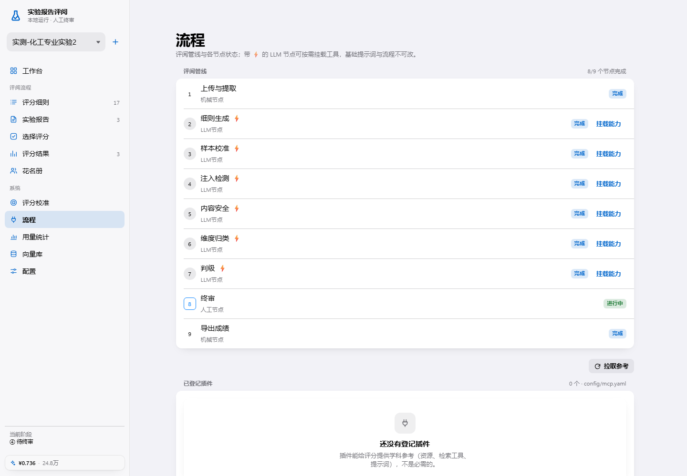

**评分校准（单份试评）** —— 上传一份教师已判过的报告，对比 AI 与教师的逐维度分歧，据此修订细则的等级边界。

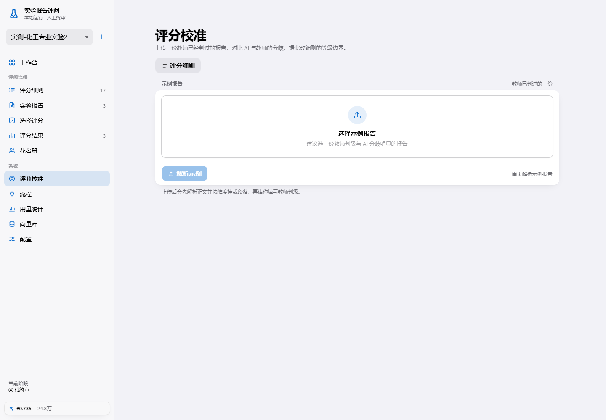

**用量统计** —— 模型调用次数、Token 拆分、账户余额与使用趋势；价目对齐 cc-switch，无定价模型显示「未定价」不乱算。

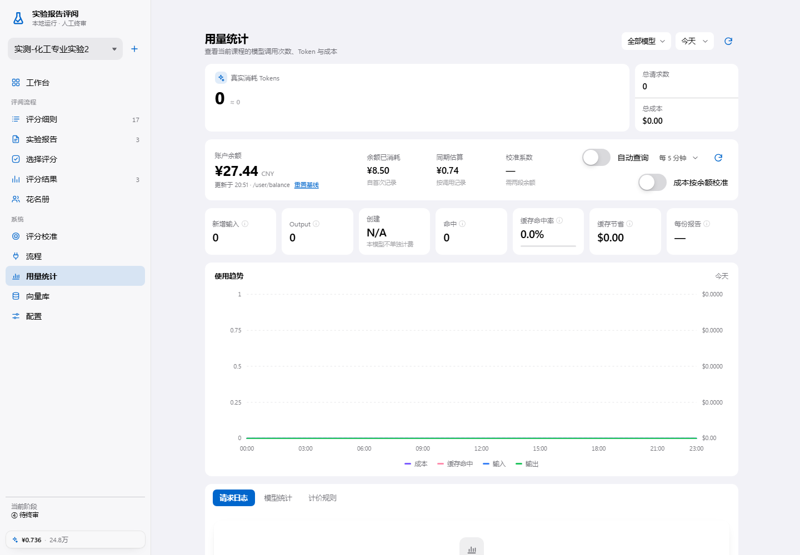

**向量库** —— 列出当前课程的全部 Chroma collection，查看条数、维度、元数据与向量预览；默认只读，清空需二次确认。

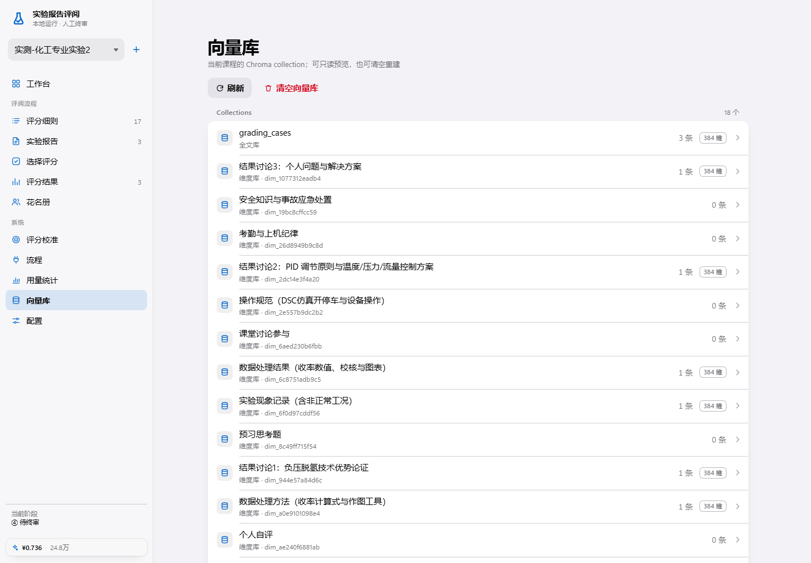

**配置** —— 模型、OCR、向量库、嵌入模型，保存即生效，内置 OCR 自检。

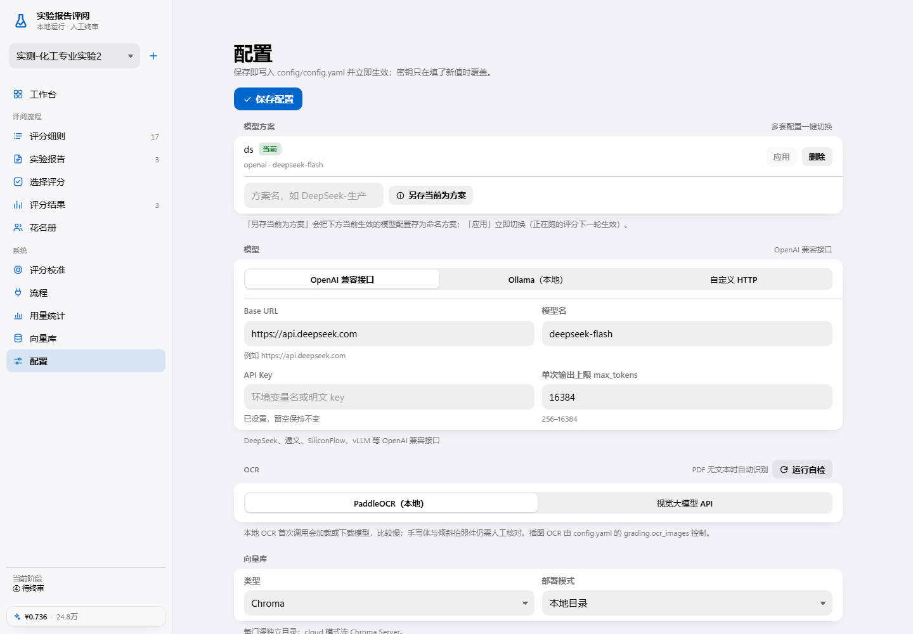

**花名册** —— 上传 .xlsx/.csv，表头决定提取与导出的列，用来统计「谁没交」「谁学号不在名单里」。

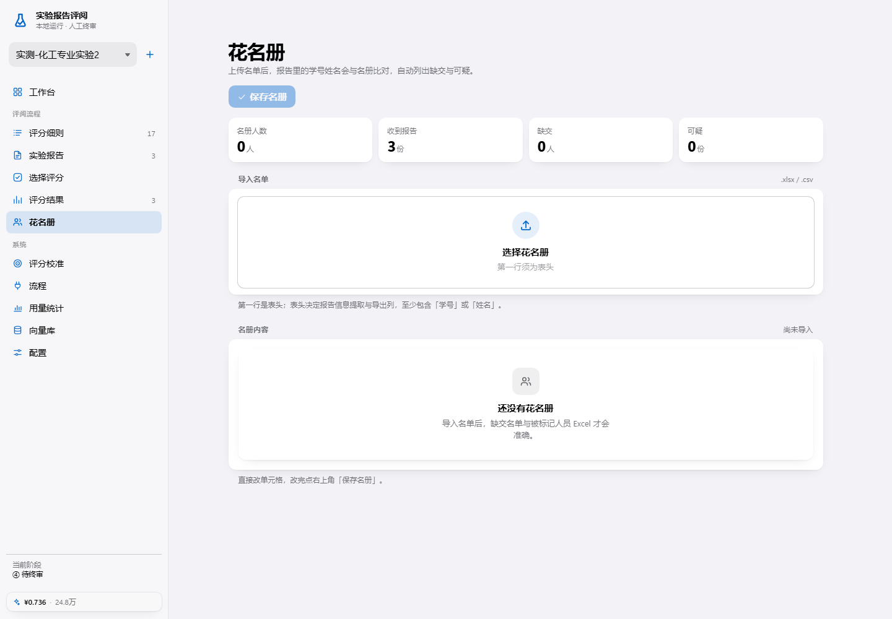

**移动端 / 窄窗口** —— 边栏折叠成底部标签栏，功能与桌面一致。

<div align="center">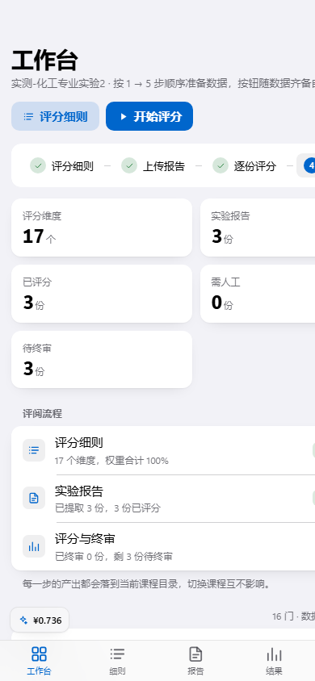 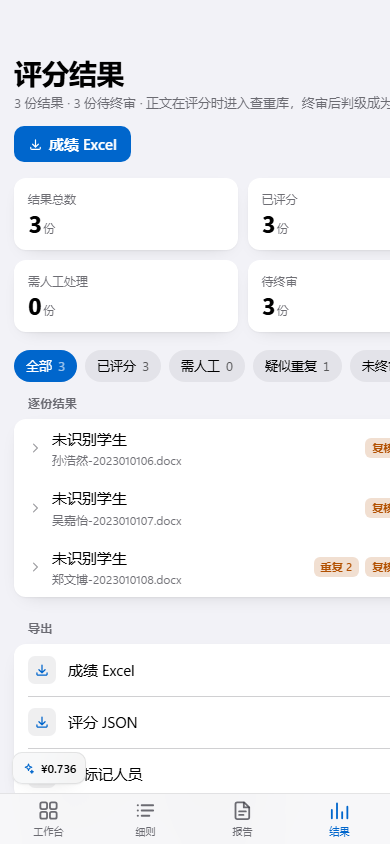</div>

---

## 5 分钟跑起来

### 0. 先确认环境

| 需要 | 版本 | 确认命令 |
| --- | --- | --- |
| Python | 3.10+ | `python --version` |
| Node.js（只用于构建前端，装一次） | 18+ | `node --version` |
| 一个大模型 API Key | OpenAI 兼容即可（DeepSeek / 通义 / SiliconFlow / vLLM…） | 去对应平台申请 |

> 只想看界面、暂不评分？可以跳过第 3 步的 Key，除「生成细则 / 评分」外的页面都能正常打开。

### 1. 装 Python 依赖

**Windows（PowerShell / CMD）**

```bat
cd 项目目录
python -m venv .venv
.venv\Scripts\activate
pip install -r requirements.txt
```

**macOS / Linux**

```bash
cd 项目目录
python3 -m venv .venv
source .venv/bin/activate
pip install -r requirements.txt
```

命令行前面出现 `(.venv)` 就对了。

> `paddleocr`、`chromadb` 体积较大，这一步可能要好几分钟。若只报 OCR 相关编译错误，可先把 `requirements.txt` 里的 `paddleocr`、`paddlepaddle` 注释掉再装，其余功能照常。

### 2. 构建前端（只有第一次需要）

```bash
cd frontend
npm install --registry=https://registry.npmmirror.com
npm run build
cd ..
```

成功会打印类似 `✓ built in 1.5s`，并生成 `src/experiment_report_grader/static/ui/`。

> `npm install` 慢或超时，先换镜像：`npm config set registry https://registry.npmmirror.com`。
> 没有 `npm` 命令说明 Node.js 没装好，去 [nodejs.org](https://nodejs.org/) 装 LTS。

### 3. 配置模型

二选一，**新手推荐方式 B**。

**方式 A：改配置文件**

```bash
cp config/config.example.yaml config/config.yaml     # Windows 用 copy
```

打开 `config/config.yaml`，改这几行：

```yaml
llm:
  backend: "openai"
  openai:
    api_key: "DEEPSEEK_API_KEY"        # 填环境变量名，或直接填 sk-xxxx
    base_url: "https://api.deepseek.com"
    model: "deepseek-chat"
    max_tokens: 16384
```

**方式 B：启动后在界面里填** —— 先启动（下一步），打开左侧「配置」，选协议、填 Base URL / 模型名 / API Key，点「保存配置」立即生效。

### 4. 启动

```bash
python run.py
```

看到这行就成功了：

```
Starting Experiment Report Grader on http://127.0.0.1:5000
```

浏览器打开 <http://127.0.0.1:5000>，应看到最上面那张「工作台」。

需要换端口或让同局域网其他电脑访问：

```bash
python run.py --port 8080 --host 0.0.0.0
```

（`--host 0.0.0.0` 会暴露到局域网，仅在你信任的网络里使用。）

---

## 完整使用流程

工作台的按钮**按数据是否齐备自动启用 / 禁用**，跟着 1→5 步走就不会错。

### ① 上传评分标准 → 生成细则

进 **评分细则**，两种模式：

- **单份标准文档**：一份文件已写明维度、权重和分级要求；
- **课程大纲 + 实验流程**：大纲给课程目标与分值构成，实验流程 / 模板给本次实验的目的、步骤、数据与产物。判据落到「大纲条目 + 实验步骤」两处，比单份标准更具体。

生成后检查：

- **权重**：保存时自动归一到 100%，不用自己凑数；
- **A–E 判据**：写得越具体，判级越稳；
- **补全**按钮：只补空字段，不覆盖你改过的内容；字段全满时禁用；保存后仍为空的字段会重新生成，缺字段会提示而非静默跳过；
- **删去不相干维度（保留分值）**：预习、课堂、考勤、操作、自评等报告里没有证据的维度会被标出并默认停用；不想停就取消勾选。停用后权重保留，导出时该列留空，之后可用「课外维度成绩」补分。

改完点右上角「保存」。**保存前会二次确认：细则一变，已提取的报告、评分结果与向量库会全部删除**（上传原件保留，重新点「处理」即可），校准确认同步失效——这是故意的，避免新旧标准混用。首次生成或课程还没有下游数据时直接保存，不打扰。

### ② 样本校准（确认后才能正式评分）

在 **评分细则** 的样本校准区：

1. 上传 **≤5 份**测试报告（只用于校准，不计入正式成绩）；
2. 点「模型评分」，按当前维度逐份打分；
3. 展开每份，看 **原文**（只读抽屉）和每个维度实际挂载的段落，按你的判断逐维选 A–E；
4. 点「保存我的等级」，显示 Cohen's κ、二次加权 κ、Krippendorff's α 和样本对数；
5. 维度可继续改，改过的标「已改」；改完需重新确认，但**不会自动重生成细则**；校准样本可单份删除（连同解析结果与上传原件）；
6. 点「确认细则，进入下一步」。确认后为每个维度建空 collection，终审时再写入；没确认或细则又改过时，`开始评分` 会被拒绝。

没有测试报告也能直接确认，只是没有一致性数据。

### ③ 上传实验报告

进 **实验报告**，多选 / 拖拽 / 直接丢一个 `.zip` `.rar` `.7z`。除 PDF/DOCX/DOC/MD 外还支持 `.html` `.pptx` `.xlsx` `.epub`——这些本地解析器不处理，会经 **markitdown 插件**（`pip install markitdown-mcp` 后在流程页或 `config/mcp.yaml` 注册）转成 Markdown；插件缺席时这些格式被跳过，其余行为不变。系统会：

- 提取正文、表格、插图、学生信息（姓名 / 学号 / 班级，按花名册表头），写进该报告的 `meta.json`，重启或切课后仍在；
- 压缩包内每份报告逐个入库（包本身不算一份）；解析不了的文件进「解析失败」清单并给出原因，原件不留在 uploads；
- 扫描件 / 无文本 PDF 自动走 OCR；
- 同一份报告重复上传自动去重；
- 表格按 Markdown 还原，公式交给 KaTeX。

列表每行可直接改学生信息、打开原文，点整行进详情。**每行有删除按钮**（二次确认）：一并删除该报告的提取目录、上传原件、评分结果、向量记录与终审记录。

### ④ 选择报告 → 开始评分

进 **选择评分**，勾选要评的报告，点右下角「开始评分」。

- 细则未确认时按钮禁用并提示先去校准；
- 同一学生有多份时只能选一份（选第二份会自动取消第一份）；
- 已终审的报告不出现在列表；
- 评分在后台跑，可离开页面，回工作台看进度。

单份约 10–40 秒。模型失败的报告标成「模型失败」，**不会伪造成 C 分**，可单独重评。

### ⑤ 终审与导出

进 **评分结果**，点开任意一份：

- 每个维度有：AI 判级 + 理由 + 原文依据；
- 不同意就点 A–E 改等级，可在「教师说明」写原因（重评时进提示词）；
- 「保存修改」只改分数，「终审入库」才写入成绩、并把这份判级作为后续范例；
- 拿不准就「打回重评」，填修改意见。

终审完成后，右上角「成绩 Excel」导出全部成绩：身份列（按花名册表头）、状态、程序化 / 语义小计、总分、模型总评、复核提示、你写的教师说明，以及每个维度一格（表头带该维度有效权重，停用维度标「不计分」且单元格留空）；若上传过「课外维度成绩」，该列自动填入并计入总分，成绩单也提供「清除」按钮（已并入分数自动回滚、小计重算）。

---

## 评分是怎么算的

- **等级与分值**：`A=95, B=80, C=60, D=40, E=0`；总分 = Σ(维度等级分 × 权重) ÷ 参与评分的权重之和，即按有效权重折算回百分制。
- **E 的含义**：不是「比 D 更差」，而是「未实现 / 缺失 / 整卷跑题 / 抄袭 / 白卷」。
- **停用维度**：标 `non_report` 的预习 / 课堂 / 考勤 / 操作 / 自评默认停用，不进评分提示词也不占分；剩余维度按各自权重折算，全 A 仍是 95 分。导出保留列并标「不计分」，取消停用即可重新计入。
- **并行评分**：默认 3 份同时跑；单份内部注入检测与内容安全并行、维度归类与判级并行。提示词、判据、维度都不变。环境变量 `ERG_GRADING_WORKERS=1..8` 可调，遇 429 / 本地显存不够就调到 1 或 2。
- **课外成绩单**：细则页可上传 `.xlsx/.csv`（列含学号 / 姓名 + 维度名，分数写 A–E 或 0–100），按学号优先合并进结果、重算小计；该维度显示「已打分」。
- **计算工具包**：判级时模型可调用 `calc_eval` / `calc_stats` / `calc_fit` 复算报告里的公式、不确定度与拟合，验算不符会写进判级理由；在流程页对应 ⚡ 节点开关。
- **维度归一与归档**：模型自创的维度名先按「精确 → 包含 → 相似度」对齐回细则名单，也接受直接返回序号；归一失败的维度记 C 并标「请人工复核」。归类完全失败时按维度名的字符二元组做关键词兜底挂载，至少不会全进「未挂载内容」。
- **防跑题**：提示词与细则生成都加了强约束——与实验主题无关的内容不得高于 D。
- **RAG**：正文在**评分时**就进全文库（算相似度）；终审时把这份判级附到全文记录上，并按维度写汇总向量——每个学生每个维度只写**一条**（该维度所有段落 / 图片合并成一个大块），没内容就不写。维度 collection 在细则确认时建立，终审时才写入。示例报告按加权总分取前 1–2 份做 few-shot。
- **相似度**：整篇报告一个向量，余弦最近邻，`≥0.92` 告警、`≥0.97` 标「高度重复」。默认用 Chroma 内置 MiniLM（英文语料、256 token 截断），模板化报告前几百字相同就会接近 1.0，这时只适合当提示、不适合当判据；要更准就在配置里换 `text-embedding-3-small` 一类并重新标定阈值。
- **一致性与缓存**：HTTP 客户端跨调用复用连接池；同一份正文的 query embedding 只算一次，维度参考不再逐维重算。
- **计价（对齐 cc-switch）**：四槽单价（输入 / 输出 / 缓存读 / 缓存写）× 各项 token ÷ 1M；价目优先级 用户覆盖（`data/output/pricing_overrides.json`）> models.dev 自动同步（≤6 小时）> 内置快照；币种随价目（用量页并列显示），无定价模型显示「未定价」不乱算。

---

## 失败兜底矩阵

模型或外部服务挂掉时，系统宁可转人工也不编造分数：

| 环节 | 失败后的行为 |
| --- | --- |
| 提示注入检测 | 标 `detection_failed`，转人工，不评分 |
| 注入检测文本超 2 万字符 | 标 `audit_truncated`，转人工，不静默放行 |
| 内容安全 | fail-open 放行，但记录「安全检测失败」 |
| 隐私脱敏 | 回退正则兜底（隐私是红线，必须替换） |
| 细则生成 | 指不到文档位置的普通维度丢弃并警告；`non_report` 维度允许缺 doc_ref，保留待停用；一个都不剩则任务失败 |
| 样本校准 | 单份模型评分失败标 `llm_failed`，不写分数；可重跑，确认状态不受影响 |
| 维度归类 | 名称对不齐时按「精确 / 包含 / 相似度」兜底；仍为空则关键词挂载，最后才进「未挂载内容」 |
| 课外成绩单 | 解析失败 / 列名不匹配直接报错，不覆盖已有分数 |
| 报告评分 | 无可用分数 → `llm_failed`，不计入成绩，可一键重评 |
| 学生信息提取 | 字段留空，人工在页面补 |
| MCP 工具 / 资源 / 提示词 | 单台失败只写状态，参考为空，评分继续 |

不依赖模型的部分（权重归一、小计、相似度、导出、花名册匹配）不受影响。

---

## 配置速查

| 键 | 说明 | 默认 |
| --- | --- | --- |
| `llm.backend` | `openai` / `ollama` / `custom`（配置页可切换） | `openai` |
| `llm.openai.api_key` | 环境变量名或明文 key（先查同名环境变量） | `DEEPSEEK_API_KEY` |
| `llm.openai.base_url` / `model` / `max_tokens` | 接口地址、模型名、单次输出上限 | — |
| `llm.ollama.base_url` / `model` | 本地 Ollama 地址与模型 | `http://localhost:11434` / — |
| `llm.custom.base_url` / `api_key` / `model` | 自定义 HTTP 网关 | — |
| `ocr.backend` | `paddleocr`（本地）或 `api`（视觉大模型） | `paddleocr` |
| `ocr.paddleocr.language` | OCR 语言 | `ch` |
| `ocr.api.api_url/api_key/api_model` | 视觉 OCR 接口 | — |
| `grading.similarity_threshold` | 全文相似度告警线 | `0.92` |
| `grading.similarity_reject` | 判为高度重复的线 | `0.97` |
| `grading.workers` | 并行评分份数（配置页可改，1–8，写回本文件） | `3` |
| `grading.ocr_images` | 是否对报告插图跑 OCR（缓存在 `reports/*/.ocr/`） | `false` |
| `vector_store.backend` | 向量库类型 | `chroma` |
| `vector_store.chroma.mode` | `local`（每课程独立目录）或 `cloud`（Chroma Server） | `local` |
| `vector_store.embedding.backend` | `default`（内置离线）或 `openai`（`/embeddings`） | `default` |
| `storage.backend` | `auto`（配了 dsn 用 PG）或 `file` | `auto` |
| `storage.postgres.dsn` | PostgreSQL 连接串（环境变量 `ERG_PG_DSN` 优先）；留空 / 连不上自动回退本地文件 | `""` |

---

## 数据在哪 / 隐私

- 默认所有数据只落在本机 `data/output/sessions/<课程>/`：`rubrics/`（细则与两份原文）、`pilot/`（样本校准的报告与 AI / 教师等级）、`reports/`（正文、插图、meta）、`grading/`（结果与导出）、`uploads/`（原件）。
- **可选 PostgreSQL**：配置 `storage.postgres.dsn` 后，全部结构化数据（细则、报告正文与 meta、评分结果、终审、用量、教师重评意见、任务 / 评分终态、校准工作区）改存 PostgreSQL，首次启用自动把本地已有 JSON 一次性导入；未配置或连接失败时静默回退本地文件，行为与原来完全一致。**不迁**的仍是本地文件：报告插图与上传原件、Excel 导出、Chroma 向量库。教师重评意见与任务终态原先只在内存（重启即丢），现在无论哪个后端都会持久化。
- 停用维度的成绩单存在 `<课程>/external_scores.json`；合并结果会写回各报告的小计。
- `config/config.yaml` 里可能有明文 key，**已被 `.gitignore` 排除**，不要提交。
- 进入 RAG 案例库前做隐私脱敏：姓名、学号、电话、邮箱、身份证、住址替换为占位符（模型不可用时用正则兜底）。
- 关掉浏览器不丢数据；重开 `python run.py` 会自动恢复上次的课程、样本校准与评分结果。

---

## 能力挂载（MCP / 技能 / 计算）

评分判级时，LLM 节点可以真实调用外部能力，按需挂、不挂也行。三类来源：

- **计算工具包** `utils/calc_tools`：`calc_eval` / `calc_stats` / `calc_fit`，复算报告里的公式、不确定度与拟合；
- **技能包** `skills/`：每个 `skill.py` 导出 `TOOLS_SCHEMA + dispatch`；
- **MCP 服务器**：stdio / http 的学科参考服务。

在 **流程** 页底部插件区点「添加插件」填表单，或直接写 `config/mcp.yaml`：

```yaml
servers:
  physics-ref:
    transport: stdio
    command: npx
    args: ["-y", "@your/physics-ref-server"]
    note: "物理实验学科参考"
  lab-http:
    transport: http
    url: "http://127.0.0.1:8931/mcp"
```

再到流程页「挂载到当前课程」勾选服务器，可选填资源过滤（`ref://physics/*`）、检索工具名、学科提示词名、参考文本上限（默认 4000 字符）。评分开始前会收集一次参考文本，注入提示词的「学科参考资料」段；插件不可用 / 超时时参考为空、评分继续，页面显示每台服务器的状态与错误原因。

详见 [docs/MCP.md](docs/MCP.md)。

---

## 项目结构

```
run.py                      启动入口（--host / --port / --debug）
config/
  config.example.yaml       配置模板（复制成 config.yaml 再改）
  config.yaml               你的运行配置（含密钥，不入库）
  mcp.example.yaml          MCP 示例
src/experiment_report_grader/
  app.py                    所有 HTTP 路由（编排层；含 /pilot/* 样本校准、/api/flow 流程页、/mcp/* 插件）
  factory.py                模型实例工厂 llm(config)（测试替换点）
  storage.py                统一持久化入口：本地文件 / PostgreSQL 双后端，PG 不可用静默降级
  nodes/                    评分业务
    grader.py               判级主流程、维度归类、RAG、相似度、function-calling 工具循环
    rubric_generator.py     细则生成 / 单元格补全 / 校准对比
    rubric_io.py            权重归一、小计、校验、Markdown、成绩 Excel 导出
    report_extractor.py     正文 / 表格 / 插图 / 学生信息提取，OCR 与解析失败归档
    agreement.py            一致性指标（κ / 加权 κ / α）
    external_scores.py      课外维度成绩单：解析、按学号合并、重算小计
  utils/                    llm_client、calc_tools（验算工具包）、skills、file_parser/doc_reader、
                            ocr、injection_detector、content_safety、privacy、safe_error、student_fields
  web/                      state（会话 / 目录 / 审批 / 挂载 / 花名册）、tasks（后台进度）、usage/pricing/balance（用量与计价）
  mcp/                      MCP 客户端（stdio / http JSON-RPC）与服务器注册表 store
  static/                   前端构建产物、KaTeX、favicon
frontend/                   React 19 + Vite 6 的 SPA（无组件库）
  src/pages/                14 个页面，一页一文件（含流程页 Flow.jsx）
  src/ui/                   按钮、分组列表、sheet、等级选择器等基础件
  src/lib/                  请求、路由、数据钩子、上下文、Markdown / 公式
  src/styles.css            设计令牌与全部样式
skills/                     可选技能包目录：每个 skill.py 导出 TOOLS_SCHEMA + dispatch
docs/
  项目运行链路图.drawio       全流程图源文件（README 内嵌其渲染快照）
  PROJECT_STRUCTURE.md        模块职责、数据流、扩展点
  MCP.md                      插件协议、示例、排障
  TESTING.md                  测试矩阵与实测结果
tests/
  run_all.py                  零依赖测试入口（无需 pytest）
  real_llm.py                 真模型测试基座（deepseek-flash）
  unit/                       单元测试
  integration/                端到端点击流程 + 基准跑批
  fixtures/                   假 MCP 服务、cn_lab 基准材料
```

---

## 开发与测试

```bash
# 后端测试（129 项，端到端调用真实模型，不需要 pytest）
python tests/run_all.py
python tests/run_all.py -k mcp        # 按名字过滤

# 前端开发模式（热更新，代理到 127.0.0.1:5055 的后端）
cd frontend && npm run dev

# 改完前端重新构建
cd frontend && npm run build
```

`python run.py` 默认跑在 5000；前端开发服务器默认 5174，代理目标写在 `frontend/vite.config.js`，需要后端跑在 5055（`python run.py --port 5055`）。

基准跑批（调用真实模型，会产生费用）：

```bash
python tests/integration/bench_run.py tests/fixtures/bench/cn_lab
```

OCR 自检：

```bash
python scripts/ocr_check.py                  # 用配置里的后端
python scripts/ocr_check.py --backend api
```

也可点「配置 → OCR → 运行自检」。本机实测（paddleocr 3.7，印刷体中英混排，阈值 0.85）：期望文本与识别结果平均相似度 1.000（仅空格差异被忽略）；手写体与低分辨率拍照件仍需人工核对，这类报告会被标为「扫描件」。

---

## 常见问题

| 现象 | 原因与处理 |
| --- | --- |
| 打开是空白页 / 404 | 前端还没构建。`cd frontend && npm install && npm run build`，再刷新。 |
| 端口被占用（`Address already in use`） | 换端口：`python run.py --port 5001`。 |
| 页面能开，生成细则报错 | 「配置」页检查 Base URL / 模型名 / API Key；`api_key` 填的是环境变量名时，确认该变量真的设置了。 |
| 细则维度全被丢弃 | 模型没给出「标准文档位置」。换个更强的模型重试，或在细则页手动新增维度后逐格「补全」。 |
| 出现「预习报告 / 课堂表现」这类维度 | 有意保留，默认已停用。要计入就取消「删去不相干维度」的勾选，或上传课外成绩单。 |
| 导出里某几列空白 | 这些维度被停用了：权重保留、不参与报告评分。上传「课外维度成绩」或取消停用即可填上。 |
| 点「开始评分」没反应 / 提示先确认 | 细则还没做样本校准并确认。去「评分细则」点「确认细则，进入下一步」。 |
| 样本一致性很低（甚至负数） | 样本太少（n<10）或维度边界模糊。先把判据写具体，再重跑模型评分。 |
| 报告详情里维度显示「0 段」 | 修复归档逻辑前的旧结果。对报告「打回重评」或重新评分一次。 |
| 表格显示成一堆竖线 / 公式没渲染 | 前端是旧构建产物。`cd frontend && npm run build` 后刷新。 |
| 评分结果全是 C，提示「LLM 未返回该维度」 | 模型输出不是 JSON。换模型重试，或对这份「打回重评」。 |
| 报告状态「模型失败」 | 同上，未返回可解析的 JSON；不计入成绩，可直接重评。 |
| 首次 OCR 特别慢 | paddleocr 首次会加载 / 下载模型，之后就快了。 |
| Chroma 报错（库被占用） | 本地向量库在 `data/output/sessions/<课程>/kb_db`，关掉旧的 python 进程再启动。 |
| 想清空重来 | 工作台底部「删除当前课程」会把 `data/output/sessions/<课程>/`（细则、报告、成绩、向量库、上传原件）整个删掉；目录删不掉时课程不会删除并提示原因。 |

---

## 已知限制

- **单进程内存态 + 无登录态**：同一课程只支持一位教师同时操作（评分线程有锁，但状态在进程内）。评分 / 上传等后台任务已做会话隔离：运行中切换课程，旧任务只写旧会话，不污染当前课程；有任何任务在跑时删课程会被拒绝。服务默认只绑 `127.0.0.1`，没有账号密码——不要暴露到公网；删课、清库、改配置这类破坏性请求要带页面里的一次性 CSRF 令牌。`--debug` 会打开 Werkzeug 交互式调试器（等于开放远程代码执行），只在可信本机临时排障时用。
- **相似度只做提示**：整篇一个向量，长报告与模板化报告会被嵌入模型截断，不能当抄袭判据；也没有段落级比对。
- **送模型的正文上限 8000 字符**（超出部分不参与评分），插图取前 20 张描述。
- **压缩包解压有上限**：单个压缩包最多 2000 个文件、单文件解压后 200MB、总解压 500MB，超限整包进「解析失败」清单且不产生模型调用；包内文件逐个入库，解析失败的原件会被清掉。
- **样本校准最多 5 份**：n 小时 κ 波动很大，只能看方向，不能当统计结论。
- **OCR 对手写体、拍照倾斜件效果有限**。
- **一致性分析需要教师真值**：样本校准里是你手填的等级；结果页的 κ 需要 `teacher_grades.json`。
- **一次评分不是一次模型调用**：注入检测、内容安全、维度归类、判级各一次，几十份报告会产生相应费用，建议先用 3–5 份试跑。
- **默认并发 3**：供应商限流或本地 Ollama 显存不足时把 `ERG_GRADING_WORKERS` 调到 1；并发只影响吞吐，不改变判级标准。

## 许可

MIT，见 [LICENSE](LICENSE)。
